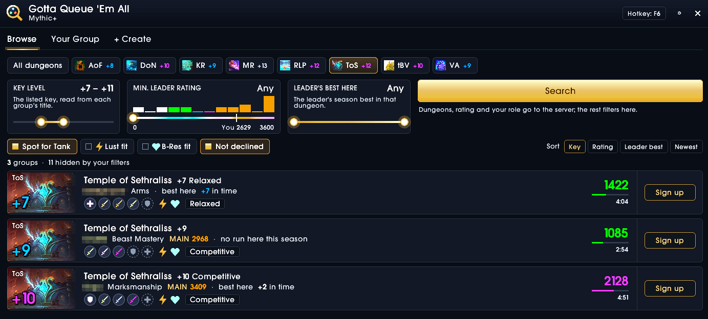
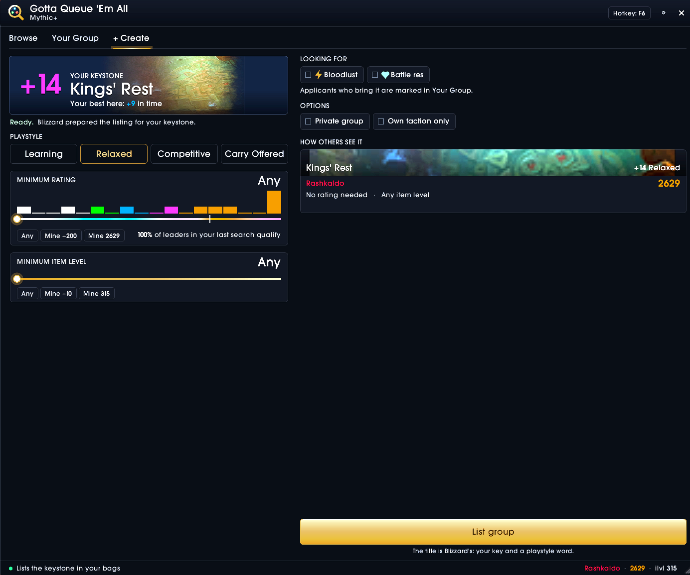

# Gotta Queue 'Em All

Your Group Finder in its own window: **Mythic+**, **Raid** and **Mythic 0**. Search
with a real key-level filter, sign up, list your group and handle your applicants,
with ratings, best runs, roles and specs, lockouts, Bloodlust / battle res and
Raider.IO info at a glance. Blizzard's window stays closed.

## Features

**Browse**
- Season dungeons as chips with your season best, a minimum leader rating slider with a
  histogram of the results, and "spot for my role".
- A key-level range slider: every group's key is read from its title, so groups outside
  the range disappear right away, without searching again.
- Cards with the dungeon's art and key, the leader (class, spec, best run in that dungeon),
  every member's role in class color, Lust / B-Res, playstyle, rating and age.
- Client-side filters: key level, leader's best in the dungeon, Lust / B-Res fit, not
  declined. Groups that don't fit are hidden, with a count of how many.
- Sort by key (lowest first), rating, leader best or newest. Sign up and cancel right on the card.

**Your Group**
- Your listing with its art, key and requirements; edit the requirements or delist.
- Your party's slots and every applicant: rating, item level, best run in your dungeon,
  Lust / B-Res, "looking for" marks. Invite and decline in one click.
- The number of waiting applicants on the tab.

**+ Create**
- Lists the keystone in your bags: playstyle, minimum rating (with how many leaders of
  your last search qualify), minimum item level, private group, own faction only.
- Blizzard's title box moves into the window: keep Blizzard's title or type your own.

**Raid**
- This season's raids (and Season 1's on request) at Normal, Heroic and Mythic, with
  your lockout on each.
- Cards with the bosses the group's lockout has killed, its size by role, the item
  level it asks for, every member as a role glyph in class color or by spec.
- Filters: difficulty, bosses killed at most, minimum group size, spot for your role,
  your item level fits, has Lust, not declined. List your own raid group with the title
  you type.

**Mythic 0**
- This season's dungeons on Mythic, no keystone needed: search, filter and list
  groups like in Mythic+; your key never ends up in the title.

**Role or Spec view**
- One switch (View: Role | Spec) next to Sort: members as role glyphs in class color,
  or with their spec under each glyph ("Resto", "BM", "Demo").

**Everything else**
- A welcome screen on the first start (`/gotta welcome` brings it back).
- Raider.IO profiles in the tooltips and a "MAIN" tag for alts, when Raider.IO is installed.
- Minimap button, a hotkey (set it with the Hotkey button in the window), the addon compartment.
- Resizable window; size and position are remembered.

## Usage

`/gotta` (or `/gqea`), the minimap button or your hotkey opens the window.
Settings: Options > AddOns > Gotta Queue 'Em All, or `/gotta settings`.
`/gotta help` lists the commands.

## Limits (set by Blizzard, not by the addon)

- Group titles can be shown but not read by addons. The key level is measured instead:
  WoW lays the title out in a special invisible font and reports its width, which gives
  the digits away ("+14", "14", "+14 Relaxed"). Titles with more numbers in them (custom
  text) stay unread and always show. If a patch stops this, the slider says so and cards
  show the title as before; `/gotta keyprobe` checks it.
- Group titles can't be written by addons, only typed by you. That's why + Create lets
  Blizzard prepare its form first and then shows Blizzard's own title box in the window.
- Searching from this window also sets the filters of Blizzard's own Group Finder
  (dungeon difficulty, roles, rating): they are shared.
- The window holds a secure button (for + Create), so it closes when combat starts.

## Feedback

Bugs and ideas: please open an [issue](../../issues).

## License

[MIT](LICENSE). Barlow Semi Condensed: SIL Open Font License (media/fonts/OFL.txt).
The textures, logo and measuring font are generated by the scripts in `tools/`.
